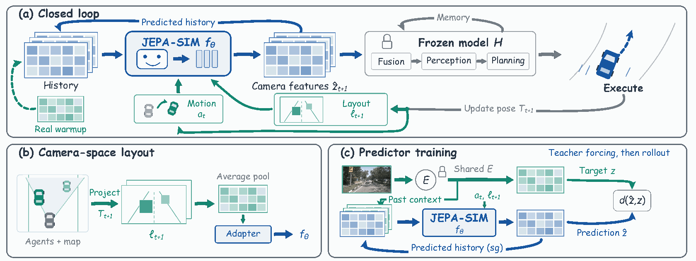
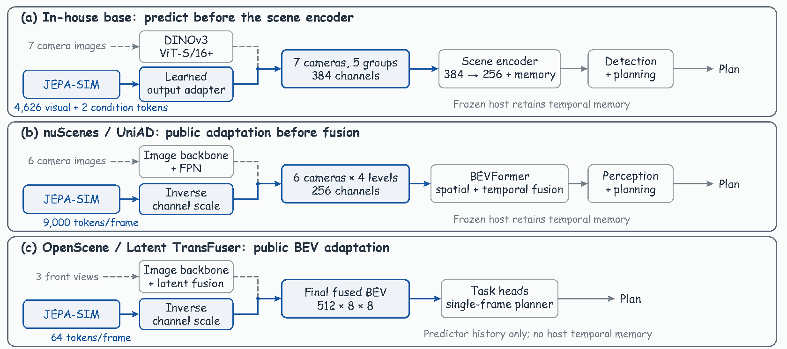

# JEPA-SIM: Render-Free Closed-Loop Driving Simulation

**Simulate what a driving model sees directly in feature space.** JEPA-SIM predicts the next
observation from feature history, executed ego motion and projected agent/map layouts. After real-image
initialization, predictions become the next history: rollout steps bypass RGB scene rendering and image
encoding, while the driving model stays frozen.

**[Pretrained models](models/README.md) · [UniAD quick start](uniad/README.md) · [NAVSIM quick start](navsim/README.md) · [Release v1.0.0](https://github.com/Bellakira7/JEPA-SIM/releases/tag/v1.0.0)**

## Why JEPA-SIM?

- **Predict at the driving model's observation interface.** On nuScenes, six-camera FPN features enter
  before BEVFormer, leaving UniAD's spatial fusion, temporal memory, perception and planning in the loop.
- **Train for repeated prediction.** UniAD uses teacher-forced initialization followed by rollout
  fine-tuning on predicted histories, with real-image targets and stop-gradient between prediction calls.
- **Improve planning agreement at lower observation cost.** The paper reports 0.165 m Plan ADE on
  nuScenes at a 0.5 s observation offset, with 28 ms observation generation; the corresponding SplatAD
  row reports 0.310 m and 280 ms. These are paper results, not a timing guarantee for a new machine.

The OpenScene adaptation uses a different interface and training recipe: it predicts Latent
TransFuser's **final fused BEV**, and evaluates a **teacher-forced checkpoint autoregressively**.
Predictors are trained separately for each frozen host; they are not interchangeable across encoders.

## Method at a glance



*Figure 2 from the accompanying paper.* Real images initialize history; predicted observations drive
the frozen policy, executed motion updates ego pose, and the new pose determines the next layout.
Real-image features supervise every prediction, including rollout steps. The diagram illustrates the
camera-feature method; the released UniAD layout adapter uses pixel-unshuffle and convolutions,
while the OpenScene adaptation pools layout conditions to its BEV grid.



*Figure S2 from the paper.* UniAD receives predicted FPNs **before fusion**; OpenScene receives
predicted BEV **after fusion**. Fixed training-channel normalization is inverted before public-host
injection, while predictor history keeps standardized features. Frozen weights do not freeze UniAD's
streaming memory. The in-house integration shown in panel (a) is not included in this public release.

## Main paper results

Plan ADE/FDE compare plans produced from generated observations with **real-image plans from the same
frozen driving model**. Observation offset is the duration of generated observations, not the planner's
waypoint horizon. Lower is better.

| Public benchmark / protocol | Observation offset | JEPA-SIM Plan ADE / FDE | Observation generation |
|---|---:|---:|---:|
| nuScenes validation / UniAD on-log AR, 3,878 common refdet targets per offset in 150 scenes | 0.5 s | **0.165 / 0.340 m** | **28 ms/step** |
| Same nuScenes protocol | 4.0 s | **0.454 / 0.977 m** | Same observation model |
| OpenScene navtest / OpenScene-LTF-AR-v2, 11,774 targets in 131 camera-complete logs, `per_token_mean` | 0.5 s | **0.293 / 0.743 m** | **14 ms/step** |
| Same OpenScene protocol | 1.5 s | **0.421 / 1.073 m** | Same observation model |

Source: paper Tables 1–2 and Appendix A.3; [all released-model reference offsets](models/README.md#reference-planning-results).
Latency covers observation generation and any image encoding, excluding downstream planning/control.
The displayed timings imply about **10×** versus SplatAD on nuScenes (280 vs 28 ms), and **18×** versus
OmniRe on OpenScene (248 vs 14 ms); these name the comparator rather than combining baselines.

On the paper's **60-scene in-house ego-closed-loop benchmark**, JEPA-SIM achieves the lowest error on
six of seven execution-consistency metrics: trajectory ADE/FDE are **0.848 / 2.545 m**, versus
**0.964 / 2.945 m** for plain 3DGS, with about **8×** faster observation generation
(45 vs 361 ms; Table 3). Surrounding traffic follows logged tracks. This study uses recorded execution
of the same frozen driving model as reference; the proprietary host, data and checkpoint are not released.

## Start here

This release contains **UniAD / nuScenes** and **camera-only Latent TransFuser / OpenScene** source,
pretrained predictors and evaluation helpers. The public main-table workflows use **logged ego motion
and layouts** to test autoregressive planning consistency; use them separately from ego-closed-loop
execution. Geometric layout projection still runs: “render-free” removes RGB scene rendering.

1. **Check the source without datasets:** follow [Tests](#tests) in a separate CPU-test environment.
2. **Use pretrained models:** [download and verify the release](models/README.md#prepare-the-model-bundle),
   install one integration and prepare its datasets/frozen host, then run its one-target smoke evaluation.
   Predictor training and feature-statistics estimation can be skipped for released weights.
3. **Reproduce the public planning results:** use the [pretrained evaluation commands](models/README.md),
   the full stated test set, matching frozen checkpoint and normalization, and the documented aggregation.
4. **Train a predictor:** follow the complete integration guide; UniAD and NAVSIM use separate environments.

| Integration | Predicted interface | Training | Inference |
|---|---|---|---|
| UniAD / nuScenes | Six-camera, four-level FPN before BEVFormer | TF initialization, then rollout fine-tuning | Autoregressive features with streaming UniAD state |
| NAVSIM / OpenScene | Final fused LTF BEV, `[B,512,8,8]` | Teacher forcing only | Autoregressive use of the TF checkpoint |

**More:** [Third-party notices](THIRD_PARTY_NOTICES.md) · [Implementation notes](docs/SOURCE_CHANGES.md) · [Recorded DSW verification](docs/README_REPRODUCTION.md)

## Contents

- [Installation](#installation)
- [Pretrained models](#pretrained-models)
- [Data and checkpoints](#data-and-checkpoints)
- [Training](#training)
- [Inference](#inference)
- [Evaluation](#evaluation)
- [Tests](#tests)
- [Repository structure](#repository-structure)
- [Acknowledgements](#acknowledgements)

## Installation

Use **Linux, Bash, Python 3.10+ and a compatible accelerator runtime** for the benchmark workflows.
The installation recipes target NVIDIA CUDA. A device reporting `torch.cuda.is_available()` alone
does not verify MMCV operators or the full frozen-host stack; run the integration's import and real-data checks.
The paper training recipes use eight GPUs with one clip per GPU. Logged-scene inference can run on one GPU.
Create separate environments for UniAD and NAVSIM because their upstream dependency stacks differ.

After cloning or unpacking the repository, run commands from its root:

```bash
export REPO_ROOT="$(pwd)"
```

Choose an integration and complete its installation and import checks:

| Integration | Environment instructions |
|---|---|
| UniAD | [Install the MMDetection 3 / MMDetection3D 1 inference stack](uniad/README.md#installation) |
| NAVSIM | [Install the locked FlowSim checkout and its NAVSIM dependencies](navsim/README.md#installation) |

`requirements-core.txt` supplies the standalone predictor-test dependencies.
The UniAD guide installs MMCV CUDA operators and the driving stack; the NAVSIM guide installs FlowSim's
loader, frozen LTF and evaluation helpers. Select a matching PyTorch/CUDA build for your GPU.

## Pretrained models

The two main accuracy predictors are prepared in a separate model bundle:

| Predictor | Stage | Parameter count |
|---|---|---:|
| UniAD / nuScenes | Rollout fine-tuning, update 6,000 | 35,938,784 |
| NAVSIM / OpenScene | Final-BEV TF, update 45,495; AR inference | 19,426,560 |

Download the weights from [GitHub Release v1.0.0](https://github.com/Bellakira7/JEPA-SIM/releases/tag/v1.0.0).
See the [model card and usage instructions](models/README.md) for checksums, normalization, reference metrics
and pretrained evaluation commands. To use pretrained weights, complete the dataset and frozen-host setup,
then follow the model card's evaluation commands.

## Data and checkpoints

Obtain datasets and frozen driving-model checkpoints from the providers listed below.
Download JEPA-SIM predictor weights from the release above and generate feature caches with the preparation scripts.

| Integration | Required inputs | Preparation guide |
|---|---|---|
| UniAD | nuScenes trainval images, sweeps, JSON metadata and maps; temporal validation infos; UniAD 2.0 checkpoint and matching motion anchors | [nuScenes preparation](uniad/README.md#data-preparation) |
| NAVSIM | OpenScene trainval logs and front-camera images; nuPlan maps; LTF seed-0 and FlowSim VH checkpoints; upstream train/test filters | [OpenScene preparation](navsim/README.md#data-preparation) |

Keep external data and generated artifacts in separate directories, for example:

```text
JEPA-SIM/
├── data/
│   ├── nuscenes/                 # samples/, sweeps/, maps/, v1.0-trainval/
│   ├── uniad/                    # temporal infos and downloaded motion-anchor pickle
│   └── openscene/                # maps/, navsim_logs/, sensor_blobs/
├── artifacts/
│   ├── uniad/                    # normalization, training checkpoints, evaluation outputs
│   └── navsim/                   # generated configs, caches, checkpoints, evaluation outputs
└── third_party/
    └── FlowSim/                  # locked external runtime for NAVSIM
```

The guides set the environment variables and generate the caches expected by each script.
Use training-only statistics matching the frozen model and predictor being evaluated.

## Training

### UniAD

Follow the [three-stage training commands](uniad/README.md#training).
The paper configuration uses three-channel map/box layouts, residual outputs at all four FPN levels,
and flow heads at P3/P4. Both fine-tuning branches start independently from the same TF initialization.

| Stage | Updates | Peak LR | Warm-up | Output under `$UNIAD_BENCH` |
|---|---:|---:|---:|---|
| TF initialization | 12,000 | `3e-4` | 500 | `train_tf_init/iter_12000.pt` |
| TF-only control | 6,000 | `1e-4` | 300 | `train_tf_control/iter_6000.pt` |
| Full rollout model | 6,000 | `1e-4` | 300 | `train_ro/iter_6000.pt` |

Fine-tuning uses camera sweeps. Rollout training uses four context frames and the horizon curriculum
`0:2,1000:4,2000:8`, ending with 12-frame clips. The TF-only control is the training ablation;
use the Full rollout checkpoint for the main UniAD workflow.

### NAVSIM

Follow the [configuration, caching and training commands](navsim/README.md#training) in order:

1. Generate configs with `navsim/configure.py`.
2. Extract real-image camera-stage caches with `navsim/parallel_pipeline.py prepare`.
3. Build the TF sequence index and symbolic conditions with `navsim/sequence_data.py`.
4. Replay frozen fusion into final BEV targets with `navsim/prepare_bev_cache.py convert`, then `merge`.
5. Train the BEV predictor with `navsim/train_sequence.py`.

The generated config selects `training_stages: ["tf"]`, no flow heads and eight GPUs.
Camera-stage caching prepares the targets for BEV predictor training.
With the paper's 96,031 five-frame windows and global batch 8, training takes 45,495 updates
with LR `3e-4`, 1,896 warm-up updates and FP32 computation.

The resulting checkpoint is:

```text
artifacts/navsim/sequence/tf/featsim_ltf.pt
```

The selected windows and global batch determine the update count. The generated evaluation config
selects the final-BEV interface, TF stage and update 45,495. For a custom training run, set the expected
checkpoint step to that run's completed update count.

## Inference

Set the integration-specific environment variables from its guide and use a trained predictor checkpoint.
Real images initialize the context; subsequent feature observations are generated autoregressively.
Motion and scene-layout conditions follow the log in these public-benchmark workflows.

For a small UniAD run:

```bash
CUDA_VISIBLE_DEVICES=0 python uniad/a_table/a_eval.py \
  --ckpt hf --scenes 0 --ctx 4 \
  --pred "featsim=$UNIAD_BENCH/train_ro/iter_6000.pt" \
  --out "$UNIAD_BENCH/inference_smoke"
```

This evaluates all legal anchors in one logged scene and saves an evaluation shard; merge it with
`python uniad/a_table/a_merge.py "$UNIAD_BENCH/inference_smoke"` to inspect non-empty common-target summaries.
For a faster startup check, add `--max-anchors 1`; the first anchor may yield only the 4.0 s offset,
so that run is not an all-offset planning comparison.
For NAVSIM, the [one-target inference instructions](navsim/README.md#inference) resolve the generated config
and run `navsim/core/eval_open_loop.py` on one target with the TF checkpoint.

For tensor-level integration, see the [UniAD predictor interface](uniad/README.md#predictor-interface)
and [NAVSIM predictor interface](navsim/README.md#predictor-interface). They document feature shapes,
condition alignment and normalization. These interfaces return predicted feature tensors for the frozen driving model.

## Evaluation

### UniAD: full validation

After completing the [UniAD environment and preparation](uniad/README.md):

```bash
CUDA_VISIBLE_DEVICES=0 python uniad/a_table/a_eval.py --ckpt hf --scene-set all \
  --pred "featsim=$UNIAD_BENCH/train_ro/iter_6000.pt" \
  --out "$UNIAD_BENCH/onlog"
python uniad/a_table/a_merge.py "$UNIAD_BENCH/onlog"
```

Outputs are `shard0of1.pkl`, `summary.json` and `summary.md` in the run directory.
Use the **refdet** summary for the main planning protocol: valid common target geometry with non-empty
real-image reference detections. The **geom** summary retains targets without that detection filter.
ADE/FDE compare generated-observation plans with real-image plans from the same frozen UniAD model.
Each observation offset is separate from the planner's waypoint horizon.

### NAVSIM: plan, run workers, merge

After training with the default generated configs:

```bash
python navsim/core/eval_sequence.py plan --config artifacts/navsim/evaluation.json \
  --out artifacts/navsim/sequence
torchrun --standalone --nproc_per_node=8 navsim/core/eval_sequence.py worker \
  --config artifacts/navsim/evaluation.json --out artifacts/navsim/sequence
python navsim/core/eval_sequence.py merge --config artifacts/navsim/evaluation.json \
  --out artifacts/navsim/sequence
```

Outputs are written to `artifacts/navsim/sequence/open_loop/`:

| File | Contents |
|---|---|
| `tokens.json` | Evaluated token list |
| `records.json` | Per-target, per-arm, per-offset metrics |
| `identity_checks.json` | Real-image vs frozen-interface replay checks |
| `stats.json` | Paired summaries, checkpoint hashes and run config |
| `results.md` | Readable planning summary |

Use `per_token_mean` planning agreement for the paper's target-averaged comparison.
`per_log_macro` uses equal log weights and is reported separately.
Human-trajectory errors under `gt/*` are different metrics from real-image planning agreement.
The NAVSIM workflow reports open-loop planning consistency.

Use fresh output directories for independent runs. Keep reference checkpoints, normalization, target selection
and inference settings fixed when comparing arms. Optional renderer and public closed-loop adapters are described
in the benchmark guides; their upstream models and assets are installed separately.

## Tests

For dataset-free CPU checks, create a separate Python environment, install a matching
[PyTorch/torchvision pair](https://pytorch.org/get-started/locally/), then:

```bash
python -m pip install -r requirements-core.txt
python tools/check_release.py
python -m pytest navsim/core/test_protocol.py -q
python -m pytest navsim/test_sequence.py -q
python -m pytest navsim/test_paper_recipes.py -q
python -m pytest navsim/test_parallel_helpers.py -q
python -m pytest tools/test_model_checks.py -q
PYTHONPATH="$PWD/uniad" python -m pytest uniad/feat/test_predictor_cpu.py -q
python -m pytest uniad/a_table/test_aggregation.py uniad/a_table/test_merge.py -q
python uniad/agreement/test_agreement.py
```

Run suites separately because the integrations retain some identical module names.
CPU tests exercise predictor forwards, sequence sampling, cache handling and aggregation with synthetic inputs.
The guides include the real-data interface checks to run after installation and asset preparation.

## Repository structure

```text
uniad/
  feat/                 # predictor, training, statistics and nuScenes data interfaces
  jepa_deps/            # attention and layout-conditioning modules
  uniad_port/           # frozen UniAD inference and streaming state
  a_table/              # on-log autoregressive evaluation and aggregation
  b_table/, offlog/     # off-log geometry, conditions and evaluation
  c_table/              # public closed-loop controller and evaluation
  agreement/            # planning/perception agreement metrics
navsim/
  configure.py          # default final-BEV / TF recipe
  sequence_data.py      # sequence index and symbolic conditions
  prepare_bev_cache.py  # frozen fusion replay and BEV normalization
  train_sequence.py     # TF training and optional rollout fine-tuning
  core/                 # frozen LTF interfaces, predictor and evaluation
models/                 # pretrained predictor model card and integrity manifest
tools/                  # source/model checks and motion-anchor conversion
```

## Acknowledgements

This implementation builds on UniAD, V-JEPA 2, NAVSIM, FlowSim and their dependencies.
See [THIRD_PARTY_NOTICES.md](THIRD_PARTY_NOTICES.md) for source relationships and separate data/model terms.
